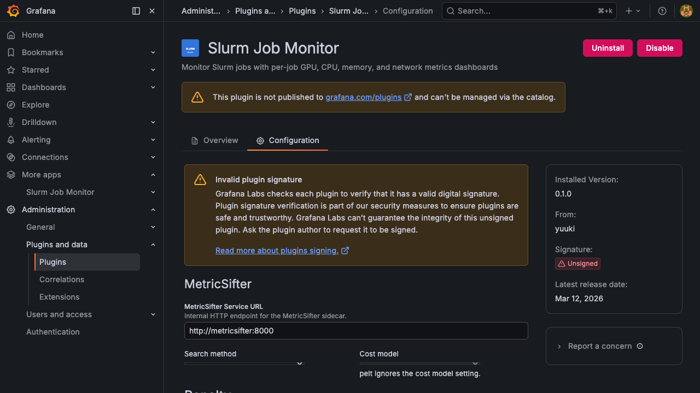

# Configuration

Configure the Slurm Job Monitor plugin by navigating to **Administration > Plugins > Slurm Job Monitor > Configuration**.

## Connection Profiles

Connection profiles define how the plugin connects to slurmdbd's MariaDB/MySQL database. You can configure multiple connections to support different database servers.

Click **Add Connection** to create a new profile.

| Field | Description | Example |
|-------|-------------|---------|
| Connection ID | Unique identifier for this connection | `default` |
| Database Host | MySQL host and port | `mysql:3306` |
| Database Name | slurmdbd database name | `slurm_acct_db` |
| Database User | MySQL user | `slurm` |
| Password | MySQL password (stored securely) | - |

## Cluster Profiles

Cluster profiles map Slurm clusters to their database connections and metrics datasources. Each cluster appears as a selectable option in the Job Search page.

Click **Add Cluster** to create a new profile.

### Basic Settings

| Field | Description | Example |
|-------|-------------|---------|
| Cluster ID | Unique identifier (used in URLs) | `gpu_cluster` |
| Display Name | Human-readable name shown in UI | `GPU Cluster` |
| Connection | Database connection to use | `default` |
| Slurm Cluster Name | Cluster name as registered in slurmdbd | `gpu_cluster` |

### Metrics Settings

| Field | Description | Default |
|-------|-------------|---------|
| Metrics Datasource UID | UID of your Prometheus or VictoriaMetrics datasource | - |
| Metrics Type | `prometheus` or `victoriametrics` | `prometheus` |
| Instance Label | Prometheus label identifying node instances | `instance` |
| Aggregation Node Labels | Comma-separated labels for metric aggregation | `host.name` |
| Node Matcher Mode | How to match nodes: `host:port` or `hostname` | `host:port` |
| Metrics Filter Label | Optional label to further filter metrics | - |
| Metrics Filter Value | Value for the filter label | - |

`host:port` mode matches any numeric port suffix on the instance label. Use `hostname` when your datasource stores hostnames without a port.

### Template Settings

| Field | Description | Default |
|-------|-------------|---------|
| Default Template ID | Dashboard template to use when auto-detection does not match | `overview` |

Available templates: `overview`, `distributed-training`, `inference`. See [Job Dashboard - Templates](./job-dashboard.md#dashboard-templates) for auto-selection criteria.

### Job Phase Settings

These settings feed the [Job Phases](./job-phases.md) section of the Job Dashboard. The feature is off unless the first field is checked. Every other field is optional; leave it empty to keep the default. The defaults are the metric names of the NVIDIA DCGM exporter and node_exporter.

| Field | Description | Default |
|-------|-------------|---------|
| Analyse job phases for this cluster | Shows the Job phases section for the cluster's jobs. Opening a job then sends up to 4 instant queries and 6 range queries to the metrics datasource, one after another; a job with hundreds of nodes needs more requests (see [Job Phases](./job-phases.md#cost)) | Off |
| GPU Power Metric | Per-GPU power gauge. Only its level relative to the job is used, so any unit works | `DCGM_FI_DEV_POWER_USAGE` |
| GPU Utilization Metric | Per-GPU utilization gauge in percent (0 to 100, not a ratio) | `DCGM_FI_DEV_GPU_UTIL` |
| Storage Write Metrics | Comma-separated counters of bytes written, at most 4; their rates are added. A checkpoint is reported only where they show a write burst. The default covers local disks only; for a network file system name a client-side counter | `node_disk_written_bytes_total` |
| Idle GPU Utilization (%) | A GPU is idle in a time bucket when none of its utilization samples exceeds this value. 0 to 50 | `5` |
| Stall Time (minutes) | Every GPU of a job idle for this long, after the job computed, is reported as stalled. 1 to 1440 | `10` |
| Smallest Checkpoint Write Rate (MiB/s) | Smallest write rate, added over a job's nodes, that counts as a write burst. 0 or more | `1` |

A metric name must be a plain Prometheus metric name (letters, digits, `_` and `:`), without a selector. `0` is a valid value for the idle threshold and the write rate. The plugin stores these settings under `phases` in the cluster profile (the switch as `enabled: true`), and stores nothing for a cluster that leaves every field alone. The settings page does not save values outside these rules.

The other thresholds are fixed; [Job Phases](./job-phases.md#how-a-label-is-decided) lists them. The CPU and network metrics are those of node_exporter and are not configurable. The section also uses the cluster's Instance Label, Node Matcher Mode and Metrics Filter.

A cluster that was migrated from the legacy single-cluster format has no phase settings, so the feature is off for it until you check the field and save.

The configuration page does not save invalid phase settings. Invalid values can still be stored by a provisioning file or by the Grafana API. They never stop the plugin: the plugin then turns the job phases off for that cluster only, writes a warning with the cluster and the reason to the plugin log (`ignoring invalid job phase settings`), and keeps every other cluster and route working. The configuration page shows a warning that names the cluster and the field when it opens. When the invalid settings asked for the feature (`enabled` is set), the Job Dashboard of that cluster shows "Job phases are off for this cluster" with the reason instead of the section.

## Access Rules

Each cluster profile can define access rules to control who can view its jobs.

| Field | Description |
|-------|-------------|
| Allowed Roles | Grafana roles that can access this cluster (Viewer, Editor, Admin) |
| Allowed Users | Specific usernames that can access this cluster |

If both fields are empty, all users can access the cluster.

## Dashboard Export

| Field | Description | Default |
|-------|-------------|---------|
| Default Export Folder | Default Grafana folder for exported dashboards. Users can override this when exporting. | `General` |

## MetricSifter Settings

If you use the [MetricSifter](https://github.com/yuuki/metricsifter) sidecar for automatic metric filtering, configure it here:

| Field | Description | Default |
|-------|-------------|---------|
| MetricSifter Service URL | HTTP endpoint of the MetricSifter service | (not set; input placeholder shows `http://metricsifter:8000` as an example) |
| Filter granularity | Controls whether MetricSifter filters at per-series or per-metric level (see below) | `Disaggregated` |
| Search method | Default change-point detection algorithm | `pelt` |
| Cost model | Default cost function | `l2` |
| Penalty | Default penalty type | `bic` |
| Penalty adjust | Penalty adjustment coefficient | `2` |
| Bandwidth | Kernel bandwidth | `2.5` |
| Segment selection method | Segment selection strategy | `weighted_max` |
| Parallel jobs | Parallelism for analysis | `1` |
| Skip simple filter | Skip the simple pre-filter step before change-point detection | `false` |

### Filter Granularity

This setting controls how MetricSifter processes time series for auto-filtering. See [Metric Explorer - Auto Filter](./metric-explorer.md#filter-granularity) for the user-facing behavior.

| Mode | Behavior |
|------|----------|
| **Disaggregated** (default) | Each individual time series (e.g., GPU 0, GPU 1, disk `sda`, disk `nvme0n1`) is sent to MetricSifter separately. Only the specific series with significant changes appear in panels. |
| **Aggregated** | All series for the same metric are averaged into a single representative value before analysis. Either all series for a metric are shown, or the entire metric is hidden. |

## Legacy Single-Cluster Migration

If you previously configured the plugin with the older single-cluster format, your settings are automatically migrated to the new multi-cluster format on plugin load. No manual action is required.
