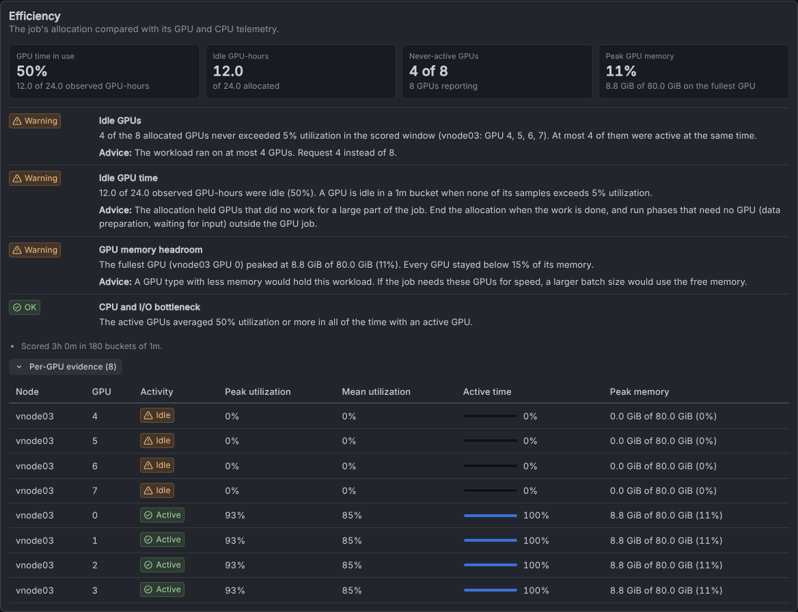

# Job Efficiency

The **Efficiency** section of the [Job Dashboard](./job-dashboard.md) compares what a job allocated (its `AllocTRES`) with what its telemetry shows over the job's run. It answers four questions:

| Finding | Question |
|---------|----------|
| Idle GPUs | Did the job use every GPU it allocated? |
| Idle GPU time | For how much of the allocated GPU time did the GPUs do nothing? |
| GPU memory headroom | How full did the GPU memory get? |
| CPU and I/O bottleneck | Did the GPUs wait for CPUs or for storage? |

Each finding shows the **evidence** it rests on. It shows **advice** only when the evidence supports it. The scorecard is read-only: it changes neither the job nor the scheduler.



## Unknown is not zero

Missing telemetry is never counted as idle or wasted. Every finding has one of these states:

| State | Meaning |
|-------|---------|
| **Warning** | The evidence shows waste or a bottleneck. The finding has advice. |
| **OK** | The evidence shows none. |
| **Inconclusive** | The telemetry cannot decide it, for example because the job shares its nodes with other jobs. |
| **No data** | The metric returned nothing for the job's nodes and time. |
| **Not applicable** | The finding does not apply, for example GPU memory when no GPU was active. |
| **Query failed** | The query for this finding failed. The other findings stay. |

A job is **not scored** at all, and no query is sent, when:

- the job's `AllocTRES` records no GPUs,
- the job has not started,
- the job ran for less than 5 minutes (with the usual 15 to 60 second scrape interval it holds too few samples per GPU, and most of its time is start-up),
- the cluster has no metrics datasource, or its efficiency settings are invalid,
- the job is larger than the scorecard reads (see [Query cost](#query-cost)).

A **running** job is scored up to now. The section says so, and **Score again** repeats the scoring. A finished job is scored once per page load.

## What is scored

### The scored window and its buckets

The scorecard splits the job's run into equal **buckets**. The buckets end at the job's end (at now for a running job) and never start before the job's start, so no bucket holds samples of the job that ran on the nodes before. Up to one bucket length at the start of the job fits no whole bucket and is not scored; the section states how much.

- A bucket is at least 60 seconds long.
- A job has at most 240 buckets. A longer job gets longer buckets: a 3-day job has 240 buckets of 18 minutes.
- A job on many GPUs gets fewer buckets, see [Query cost](#query-cost).

### Which series belong to the job

The job's series are selected like the dashboard panels select them: by the job's node list and the cluster's Instance Label, Node Matcher Mode and optional Metrics Filter. slurmdbd does not record which GPUs of a node a job holds, and the exporters do not label series with the job. So the scorecard compares counts:

| GPUs reporting on the job's nodes | Meaning | Result |
|-----------------------------------|---------|--------|
| As many as the job allocated | The job holds every GPU of its nodes. | Exact numbers. |
| More than the job allocated | The job shares its nodes, or holds only some of their GPUs. The telemetry cannot tell which GPUs are the job's. | Lower bounds, marked with ≥, or **Inconclusive**. |
| Fewer than the job allocated | Some allocated GPUs have no telemetry. | The reporting GPUs are scored. The others count as "no telemetry". |

The lower bound works as follows. If the nodes report 8 GPUs, the job allocated 6, and only 1 of the 8 was ever active, then at most 1 of the job's GPUs was active, so at least 5 never were. If 6 or more of the 8 were active, nothing can be shown either way.

### Idle GPUs

A GPU is **active** in a bucket when at least one utilization sample of that bucket exceeds the **idle baseline**. The default baseline is 5% utilization.

```
active(gpu, bucket) = max_over_time(utilization[bucket]) > idle baseline
```

- An **idle GPU** is a GPU that was active in no bucket.
- A GPU that was active in no bucket, but reported in fewer than half of the buckets in which any GPU of the job reported, is **too little data**. It is not counted as idle.
- The finding also states the highest number of GPUs that were active in the same bucket.

**Warning** when at least one allocated GPU was idle. The advice names the number of GPUs the workload ran on.

Why 5%: DCGM reports utilization as the share of time in which a kernel ran on the GPU. A GPU without work reports 0. A few percent come from context creation and monitoring, not from a workload. The test uses the highest sample of the bucket, so one sample above the baseline marks the whole bucket as active. This is lenient on purpose: idle time is never overstated.

Only utilization is used. The issue that proposed this feature also mentions power. Idle power differs by GPU model, so it has no baseline that holds for every cluster.

### Idle GPU time

Every bucket splits the allocated GPU time three ways:

```
active   = GPUs active in the bucket      x bucket length
idle     = GPUs reporting but not active  x bucket length
no data  = allocated GPUs not reporting   x bucket length
```

- **Idle GPU-hours** is the sum of `idle` over all buckets.
- **GPU time in use** is `active / (active + idle)`. Time without telemetry is in neither part.

**Warning** when at least 25% of the observed GPU time was idle. A healthy batch job measures close to 0%, because a bucket with a single active sample counts as active. 25% leaves room for the start-up of a short job (5 minutes of staging in a 20-minute job).

On shared nodes, a bucket in which more GPUs report than the job allocated gives a lower bound: at least `allocated - active` GPUs were idle.

### GPU memory headroom

For every GPU the scorecard reads the highest memory use and the lowest free memory of the scored window:

```
capacity   = peak used + lowest free
peak share = peak used / capacity
```

At the moment of the peak the free memory is at its lowest, and the two add up to what the device offers. Memory that the driver reserves is not part of either metric, so the share is slightly overstated, never understated.

**Warning** when the fullest GPU stayed below the **low memory threshold** (default 15%). The advice is a GPU type with less memory, or a larger batch size. The default is the value the feature request names. It is conservative: it flags only jobs that would fit a device with a small fraction of the memory. The numbers are always shown, so you can judge the cases in between.

- On shared nodes the fullest GPU may belong to another job. A low value still holds for the job, because the job's GPUs cannot be fuller than the fullest GPU of its nodes. A high value is **Inconclusive**.
- If a GPU has no memory telemetry, a low value is **Inconclusive**, because that GPU may be fuller.
- **Not applicable** when no GPU was active.

### CPU and I/O bottleneck

This finding looks for an input pipeline that cannot feed the GPUs. It uses the buckets in which at least one GPU was active and CPU telemetry exists. In such a bucket:

```
GPUs underused = mean utilization of the active GPUs < 50%
CPUs saturated = busy CPUs      >= 90% of the job's CPUs
I/O wait high  = CPUs in iowait >= 10% of the job's CPUs
busy CPUs      = CPUs - idle CPUs - CPUs in iowait
```

- **CPU-bound** (Warning): underused GPUs and saturated CPUs coincide in at least 25% of these buckets. Advice: more CPUs per GPU, more data-loader workers.
- **I/O-bound** (Warning): underused GPUs and high I/O wait coincide in at least 25% of these buckets. Advice: faster or node-local storage.
- Otherwise **OK**. The evidence still states how often the GPUs were underused and how many CPUs were busy then. Few busy CPUs next to underused GPUs point to a single-threaded data loader; the scorecard shows the numbers and leaves the conclusion to you.

Idle GPUs are not part of this finding. A phase in which the job uses no GPU at all is idle GPU time, not a bottleneck.

The thresholds are fixed. 90% busy and 10% I/O wait are common alerting thresholds for hosts; 50% means that the GPUs waited for more than half of the time.

The CPU metrics are per node, in CPUs: `rate(node_cpu_seconds_total[5m])` summed over the job's nodes. For buckets longer than 5 minutes this samples the last 5 minutes of each bucket. They are compared with the job's allocated CPUs (`cpu` in `AllocTRES`):

| The job holds | Result |
|---------------|--------|
| Every CPU of its nodes | The node's CPU load is the job's. A bottleneck can be reported. |
| Fewer CPUs | The node's load includes other jobs. If even the node-wide load stays under the job's levels, the finding is **OK**. Otherwise it is **Inconclusive**. |
| An unknown number (no `cpu` in `AllocTRES`) | **Inconclusive** |

Two more cases are **Inconclusive**: the nodes export no `iowait` mode, so an I/O bottleneck cannot be ruled out (a CPU bottleneck is still reported); or `node_cpu_seconds_total` does not add up to one second per second and CPU, so it is not node_exporter's per-CPU counter.

Slurm counts the CPUs it is configured with. If Slurm is configured with cores and the nodes run two threads per core, node_exporter reports twice as many CPUs, and the job counts as holding only some of them.

## Thresholds

| Threshold | Value | Configurable |
|-----------|-------|--------------|
| Idle baseline (GPU utilization) | 5% | Per cluster: Idle GPU Utilization (%) |
| Low GPU memory | below 15% of capacity | Per cluster: Low GPU Memory (%) |
| Idle GPU time warning | at least 25% of the observed GPU time | No |
| Underused GPUs | active GPUs average below 50% | No |
| CPUs saturated | at least 90% of the job's CPUs busy | No |
| I/O wait high | at least 10% of the job's CPUs in iowait | No |
| Bottleneck | coincides in at least 25% of the buckets with an active GPU | No |
| Shortest job scored | 5 minutes | No |
| Coverage for an idle GPU | reported in at least half of the job's observed buckets | No |

## Per-GPU evidence

**Per-GPU evidence** lists every GPU with its activity, highest and mean utilization, the share of its observed buckets in which it was active, and its peak memory. Idle GPUs come first.

## Requirements

- GPU metrics with one series per GPU. The defaults are the names of the [NVIDIA DCGM exporter](https://github.com/NVIDIA/dcgm-exporter): `DCGM_FI_DEV_GPU_UTIL` (percent), `DCGM_FI_DEV_FB_USED` and `DCGM_FI_DEV_FB_FREE` (MiB), with the GPU in the `gpu` label. Other names and another GPU label can be set per cluster, see [Configuration](./configuration.md#efficiency-settings). The units must be the same: percent and MiB.
- For the CPU and I/O finding: [node_exporter](https://github.com/prometheus/node_exporter)'s `node_cpu_seconds_total` with one series per CPU and the modes `idle` and `iowait`. This name is fixed. Without it the finding is **No data**; the GPU findings do not need it.
- A Prometheus or VictoriaMetrics datasource that keeps the job's time range. Parts of a job that are older than the retention are "no telemetry".

## Query cost

One scorecard sends at most 7 queries, one after another, through Grafana's datasource proxy. Every query aggregates in PromQL; none returns raw samples.

| Queries | Kind | Response |
|---------|------|----------|
| GPU utilization: bucket peak and bucket mean | 2 range queries | one point per GPU and bucket |
| GPU memory: peak used and lowest free | 2 instant queries | one sample per GPU |
| CPUs: idle, in iowait, count | 3 range queries | one point per bucket |

- GPUs x buckets is at most 24,000 points per query. The GPU count is taken as the allocated GPUs, or 8 GPUs per node if that is more. A job on 320 GPUs has 75 buckets; a job on 2,000 GPUs has 12.
- A job whose nodes are expected to report more than 24,000 GPUs is not scored.
- The CPU queries are not sent when their result could not change the finding (shared GPUs, no active GPU). The GPU memory and CPU queries are not sent when the utilization metric has no data.

## Limitations

- The telemetry is per node and per GPU, not per job. On shared nodes the scorecard gives bounds or says **Inconclusive**, as described above.
- Allocated memory and the time limit are not compared with usage.
- The scorecard covers one job. To rank jobs, use the **Idle GPU-h** column of [Job Search](./job-search.md#idle-gpu-hours). It ranks the loaded jobs by a lower bound of their idle GPU-hours; there is no cluster-wide ranking over every job of a time range, and no sum per user or partition.
- The scored values depend on the scrape interval: a scrape interval longer than a bucket leaves buckets without data, which count as "no telemetry".
