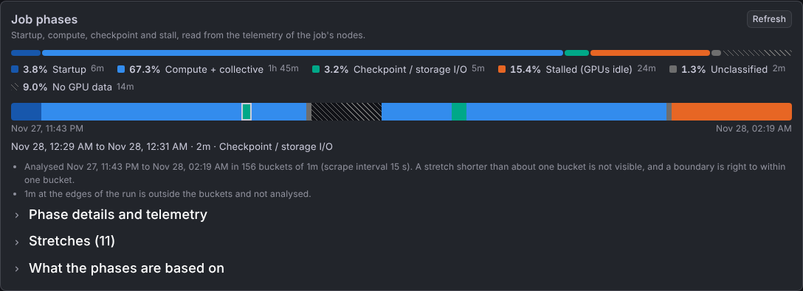

# Job Phases

The **Job phases** section of the [Job Dashboard](./job-dashboard.md) splits a job's run into stretches and says how much time the job spent in each phase: startup, compute, checkpoint, stalled. Time that fits no phase is shown as **Unclassified**, with the reason, and time without GPU telemetry as **No GPU data**. Neither is counted as a phase.

The feature is **off by default**. An administrator turns it on per cluster in the [Job Phase Settings](./configuration.md#job-phase-settings). A cluster that does not turn it on shows no section and sends none of its queries.

The phases are labels for what the telemetry of the job's nodes showed. They are not read from the job: the plugin does not know what the job's code did.

## What the section shows

- **Breakdown bar and legend**: the share of the analysed window per label, for example `5.1% Startup, 72.2% Compute + collective, 3.1% Checkpoint / storage I/O, 19.6% Stalled (GPUs idle)`. The shares are printed with one decimal and add up to 100.0%. Unclassified time and time without GPU data have their own shares.
- **Timeline**: the stretches in time order. The strip always spans exactly the analysed window, and every block starts and ends at the true times of its stretches. Hover a block to read its window, length and label. Click it to zoom the metric panels to it (a metric must be pinned, so that a panel exists). Neighbouring stretches that are each shorter than 1/360 of the window (two pixels on a strip of 700 pixels) cannot be drawn one by one: such a run is drawn as one block whose bands show the shares of its labels from bottom to top, and a note under the strip says so. A single short stretch between two long ones keeps its own block; when it is narrower than a pixel it may not be visible.
- **Notes**: the analysed window and its resolution, and everything that limits the result for this job: missing signals, nodes without telemetry, a node whose GPUs were idle while other nodes worked.
- **Phase details and telemetry**: per label the time, the share, the number of stretches and the typical telemetry (medians), so that you can check a label against the numbers. GPU power is printed without a unit, because the power metric is configurable and only its ratio to the job's working level is used.
- **Stretches**: the stretches as table rows (the first 100 when there are more), with **Zoom** and, when [Annotation Labeling](./annotation-labeling.md) is enabled, **Label…**. A stretch without GPU data has no **Label…**.

The tables scroll sideways inside the section when the page is narrower than a table.
- **What the phases are based on**: the metrics that were read, how much of the window each covers, and the thresholds of this job.

For a job that Slurm records as RUNNING, a warning appears when the job is stalled now. A job without an end time in another state (suspended, pending again after a requeue, completing) gets no warning; a note names the state.

## The labels

| Label | What the telemetry showed |
|-------|---------------------------|
| **Startup** | The time before the GPUs first reached their working level. |
| **Compute + collective** | Most nodes had their GPUs at the working level. Collective communication is part of this phase, because its bursts inside a training step are far shorter than a bucket. |
| **Checkpoint / storage I/O** | GPUs below the working level, or idle, together with a storage write burst. |
| **Stalled (GPUs idle)** | Every GPU of the job idle for at least the stall time, after the job had computed, with the CPUs idle too. The label names what was observed: a hang, and a job that waits (an interactive session, a `sleep` at the end), look the same. |
| **Unclassified** | GPU telemetry exists, but the stretch fits none of the four phases. The section gives the reason (see below). |
| **No GPU data** | No node of the job reported GPU telemetry. |

Reasons for **Unclassified**:

| Reason | Example |
|--------|---------|
| GPUs below the working level but not idle, without a storage write burst | An evaluation step, a data wait |
| Every reporting GPU idle for less than the stall time, without a storage write burst | A short pause between steps |
| GPUs below the working level, or idle for less than the stall time; the storage write rate is unknown | The cluster exports no storage write series, so a checkpoint cannot be told |
| Every GPU idle for the stall time, but the CPUs were not idle | CPU-only work, or a hang that spins on the CPUs; the telemetry cannot tell them apart |
| Every GPU idle for the stall time, but the stretch has too little CPU telemetry | The cluster exports no CPU series, so a stall cannot be told from CPU-only work |
| Every reporting GPU idle for the stall time, but not every node reported | One node's exporter was down |
| No majority | Half of the nodes at the working level, half not |
| At most half of the nodes reported GPU telemetry | |
| In no bucket did more than half of the nodes reach the job's working level | A job that never used its GPUs. It is not reported as stalled: there is no compute to compare with. Also a job whose nodes have different GPU models, when most nodes have the weaker model (see "Nodes and GPUs") |
| GPU power is flat and there is no utilization series | Working cannot be told from idle |

## How a label is decided

1. **Buckets.** The run is split into buckets of equal length (see [Resolution](#resolution)). Every signal is reduced to one value per node and bucket by the metrics backend.
2. **GPU state of a node in a bucket.**
   - *Idle*: no utilization sample of any GPU of the node exceeds the idle threshold (5%).
   - *Working*: not idle, and the node's mean GPU power and mean GPU utilization both reach half of the job's **working level**.
   - *Below the working level*: everything else with telemetry.
3. **Working level.** The 90th percentile of the node buckets that are not idle, for power and for utilization separately. It is a property of the job, so a power-capped job, or a job on another GPU model, is measured against its own level. A working level in utilization must be at least twice the idle threshold; a job that stays below it has no working level.
4. **The job in a bucket.** *Compute* needs more than half of the job's nodes working. *Every GPU idle* needs all nodes of the job to report and be idle. Most nodes below the working level is *GPUs low*. Anything else is unclassified (no majority, or too few nodes report).
5. **The label.**
   - Compute buckets are **Compute + collective**.
   - GPUs-low buckets before the first compute bucket are **Startup**.
   - After the first compute bucket, a bucket with GPUs low, or with every GPU idle, is **Checkpoint / storage I/O** when it has a storage write burst. A burst needs two things: at least one node writes 1 MiB/s or more, and the job's nodes together write at least three times the median write rate of the compute buckets. Small writes of many nodes do not add up to a burst: 64 nodes that each write 20 KiB/s of logs are not a checkpoint.
   - A run of every-GPU-idle buckets that lasts for the stall time (10 minutes) is decided as a whole, first by the CPUs. The run is found from the GPUs alone, so a write inside it does not split it.
     - CPUs idle on every node (see the table): **Stalled**, whatever the storage writes. Writes of the job and writes of anything else on the node cannot be told apart, so they never turn idle GPUs and idle CPUs into a checkpoint.
     - CPUs not idle and a write burst in more than half of the buckets: **Checkpoint / storage I/O**.
     - CPUs not idle otherwise, or too little CPU telemetry: **Unclassified**, with the reason.
     - Every stretch of such a run states what was seen, whatever its label: how long every GPU was idle, the CPU load of the busiest node, and in how many buckets the storage wrote at burst level.
   - The rest is **Unclassified**, with the reason.

| Threshold | Kind | Default | Configurable |
|-----------|------|---------|--------------|
| Idle GPU utilization | Absolute: a percentage means the same on every GPU model | 5% | Yes |
| Working level | Relative to the job: 90th percentile of its active node buckets | - | No |
| A node works at | Relative: half of the working level | 0.5 | No |
| Smallest working level | Absolute: twice the idle threshold | 10% | With the idle threshold |
| Stall time | Absolute | 10 minutes | Yes |
| Write burst | Relative: three times the median of the compute buckets, over the job's nodes | 3x | No |
| Smallest write burst | Absolute, on at least one node | 1 MiB/s | Yes |
| CPUs idle (a stall needs it) | CPU load of the busiest node (its median over the idle run) below a quarter of the median of the compute buckets, and never below 1% or above 5% of CPU time | 1% to 5% | No |

GPU power is used only relative to the job, so its unit and the GPU model do not matter. No threshold is in watts.

**Network** (bytes sent and received) is shown per phase as evidence. It decides no label.

## What it can and cannot see

### Resolution

Telemetry arrives at the scrape interval. A bucket holds at least four scrapes of the slower of the GPU and CPU series, and is at least one minute long. The storage write and network counters do not lengthen the buckets: a counter that is scraped more slowly than the buckets need has its rate read over a longer window around each bucket (at least four of its own scrape intervals). The labels then keep the resolution of the GPU and CPU series, and the section names the slow counter, its interval and the window.

What a slow storage counter does to checkpoints: a write burst is spread over the rate window. With a storage exporter scraped every 300 s the window is 20 minutes. A GPU dip within 10 minutes of a write burst can then read as a checkpoint although the write was not in the dip, and a burst that is short against the window can fall under the burst level and be missed. Measured: the same 125-minute job with two 4-minute checkpoints gave the same stretches with a storage exporter scraped every 15 s and every 300 s, on both backends.

| Scrape interval | Shortest bucket |
|-----------------|-----------------|
| 15 s | 1 min |
| 30 s | 2 min |
| 60 s | 4 min |

Buckets get longer for long jobs (at most 1,440 buckets) and for jobs with many nodes (at most 24,000 node buckets per query). A 3-day job on 2 nodes at a 60 s scrape interval gets 4-minute buckets; a 1-day job on 256 nodes gets 20-minute buckets. The section states the bucket length of each result.

What follows from this:

- A stretch must fill most of a bucket to change the bucket's label. A stretch much shorter than a bucket is **not visible**; its time is part of the surrounding label.
- A boundary is right to within one bucket.
- A stretch of about half a bucket to one bucket is seen in some cases only, and then reported as one whole bucket.
- From two buckets on, a stretch is seen reliably.
- Bursts of collective communication inside a training step last milliseconds. They are not visible at any bucket length, which is why compute and collective are one phase.
- Evaluation on the GPUs looks like compute. A phase is told by GPU activity, not by what the code does.
- A checkpoint that is written in the background while the GPUs keep working is not a phase of its own: the job computes.
- A job that alternates between GPU work and waiting with a period near the bucket length (seconds to minutes) gets many short unclassified stretches: each bucket holds only a few samples of each GPU.

Measured on generated jobs with a known timeline, sampled like a real exporter, with noise (20 jobs per row; `src/pages/JobDashboard/phases/accuracy.test.ts`):

| Scrape, bucket | Buckets that lie inside one phase, labelled right | Boundary error, mean | Boundary error, largest |
|----------------|---------------------------------------------------|----------------------|-------------------------|
| 15 s, 1 min | 3007 of 3007 | 14 s | 39 s |
| 30 s, 2 min | 3000 of 3000 | 33 s | 76 s |
| 60 s, 4 min | 3000 of 3000 | 61 s | 138 s |

The wrong labels are all in buckets in which two phases meet. Share of the true checkpoint time that is reported, by checkpoint length, in 1-minute buckets: 15 s: 0%; 30 s: 30%; 45 s: 85%; 60 s: 81%; 90 s: 91%; 2 min: 91%; 5 min: 96%.

These numbers come from generated data. Real telemetry has not been measured.

### Checkpoints need a write series

A checkpoint is reported only where the configured storage write metrics show a burst. The default, `node_disk_written_bytes_total`, covers **local disks only**. A checkpoint to a network file system (Lustre, GPFS, NFS) does not show in it: the GPUs dip, and the dip is unclassified. To see such checkpoints, name a client-side write counter of that file system in the settings. Without any write series, no checkpoint is reported and the notes say so.

The scrape interval of a counter is measured in the last ten minutes of the run, so an interval of more than five minutes cannot be measured, and the rate window stays one bucket. Such a counter has fewer than two samples in a bucket. On Prometheus its signal then has the state "too few samples for a rate" and is treated like a missing series (not like a rate of zero); VictoriaMetrics computes a rate from the last sample before the bucket, which spreads a burst over the scrape interval. Measured with a storage exporter scraped every 7 minutes: Prometheus reported "too few samples" and no checkpoint; VictoriaMetrics reported 3 minutes of checkpoint for two true checkpoints of 4 minutes.

### Stalls

- **Idle between steps** is not a stall: an idle stretch shorter than the stall time is unclassified.
- **A finished job** is not read past its end, and a running job is read up to one minute plus two scrape intervals before now, so that samples that are not stored yet do not read as missing or idle.
- **Missing data** is never idle. A bucket without GPU telemetry is *No GPU data*, and it ends a run of idle buckets.
- **One stalled node of many**: the job stays in compute while most nodes work. The notes name each node whose GPUs were idle for the stall time while at least one other node worked, and for how long. In a job of two nodes there is no majority when one node stops: the stretch is unclassified ("No majority") and the notes name the node.
- **A stall needs idle CPUs on every node.** For each node the plugin takes the median CPU load over the idle run, and the busiest node decides. Its load must be below a quarter of the job's own CPU load in its compute buckets. The limit is never under 1% of CPU time (the background load of a node) and never over 5%. With compute at 60% CPU the limit is 5%; with compute at 10% it is 2.5%; with compute at 4% or less it is 1%.
- **CPU-only work** with idle GPUs is unclassified, not stalled, when it keeps the CPUs of at least one node at or above that limit. This includes work that is less busy than the compute phase (post-processing at 54% after compute at 60%) and work on one node of many. A hang that spins on the CPUs looks the same and is unclassified too. The stretch states the CPU load of the busiest node.
- **CPU-only work below the limit is reported as stalled.** The CPU load is the mean over the cores of a node, so work on a few cores of a large node is small. Two measured examples: work on 2 of 256 cores (0.78%) and one thread on a 64-core node (1.56%), both after compute at 40% (limit 5%), are reported as stalled, and a running job gets the "stalled now" warning. The Stalled row and the stretch show the CPU load.
- **A hang of a job that uses little CPU can stay unclassified.** With compute at 3% CPU the limit is 1%. A hang during which the node's background load is 1.2% is then "CPUs not idle", unclassified, without a warning. The two limits come from the same cause: the mean over the cores cannot tell one busy core from a little load on every core. The busiest core would tell them apart, but it needs one more query over the per-core CPU counters, the heaviest series the section reads; it is not read.
- **A CPU value outside 0 to 100%** is left out for its node and bucket only, and the notes say how many values were left out. Such values come from a node exporter that answers late. The CPU signal as a whole is not used only when more than a tenth of its values are outside the range; the notes then say so, with the counts.
- **Without a CPU series no stall is reported.** Idle GPUs then stay unclassified, with the reason "too little CPU telemetry". The same holds for an idle run in which no node has CPU values in at least half of the buckets.
- **Storage writes never hide a hang.** The idle run is counted first, and with idle CPUs it is stalled whatever the storage writes: an error log of 2 MiB/s through the whole hang, or another job that writes 50 MiB/s on the same node, leave it stalled. The stretch states the writes. The other side of this rule: a real checkpoint that lasts for the stall time or longer, with every GPU idle and the CPUs under the limit, is reported as stalled too, with its writes stated ("a long checkpoint with idle GPUs looks the same"); a running job then gets the "stalled now" warning. Set the stall time above the length of such checkpoints. A long idle run is called a checkpoint only when the CPUs are not idle and the storage writes at burst level in more than half of its buckets.
- **A GPU that spins at full utilization** without doing work is not idle. It is seen only through power: when the power is under half of the working level, the stretch is unclassified (GPUs low).
- **One active GPU sample ends an idle run.** A hang in which one GPU shows a utilization sample above the idle threshold every few minutes has no idle run of the stall time and is not reported as stalled; its stretches are unclassified ("idle for less than the stall time").
- **GPU work at or below the idle threshold** (sparse inference at 3 to 5% utilization) counts as idle GPUs, and as a stall when the CPUs are idle too. Lower the idle threshold in the settings for such workloads.
- **A suspended job** has idle GPUs. The plugin knows only whether the job is suspended now and says so; an earlier suspension reads as a stall.
- **A job that Slurm records as running after it ended** (a runaway job) has idle GPUs and reads as stalled now.
- **A hang that keeps the GPUs busy** looks like compute. A hang that keeps GPU utilization above the idle threshold (for example 12% from a polling thread) is not idle either: it is unclassified (GPUs low) while the working level comes from real compute, and it reads as compute when it fills more than nine tenths of the active time of the job.
- The stall time is counted over a run in which no reporting GPU was active and more than half of the nodes reported. A bucket is labelled stalled only when every node reported in it.

### Nodes and GPUs

- GPU telemetry is read **per node**. When the job's nodes report more GPUs than the job allocated, the node averages would include other jobs, and the section gives **no result** for the job. The GPUs of each node are counted in three windows of ten minutes: at the end of the run, ten minutes after its start and in its middle (a job shorter than 20 minutes has one window, a job shorter than 30 minutes two). The count of a node is the median of the windows in which it reports, so a node whose exporter is silent at the end of the run is still counted, and an exporter restart, which shows every GPU twice in one window, does not refuse the job. GPUs of another job that report in none of these windows are not seen. Anything that makes a node export more utilization series than Slurm counts GPUs has the same effect: the same exporter stored twice (set the cluster's Metrics Filter to one copy), or one series per GPU partition.
- When fewer GPUs report than the job allocated, the result covers the GPUs that report, and the notes say so. A GPU whose series is missing while the other GPUs of its node report is not noticed.
- CPU load, storage write and network are node-wide. Another job on the same node adds to them.
- A job on nodes with different GPU models has one working level for all nodes, and the level in power comes from the stronger GPUs. Nodes with weaker GPUs can read as below the working level although they work at full utilization. When most nodes have the weaker model, the whole job is unclassified with the reason "In no bucket did more than half of the nodes reach the job's working level".
- The working level is the level the GPUs held or exceeded in a tenth of their active buckets. A job with short bursts at a much higher level than its steady work has that steady work reported as unclassified (GPUs low).

### Edges

Bucket boundaries are multiples of the bucket length, so less than one bucket at each end of the run is outside the buckets. The section states how much. On VictoriaMetrics a rate reaches back one scrape interval before its bucket, so a checkpoint can be reported up to one bucket longer.

## When there is no result

| Message | Queries sent |
|---------|--------------|
| The job has not started, or has no node | 0 |
| The job is too short (fewer than 5 buckets fit into the run) | 0, or the probes (up to 4) when the scrape interval decides it |
| The job has more than 2,000 nodes | 0 |
| The job allocated no GPU and its nodes report no GPU utilization at the end of the run | 1 |
| The job's nodes report more GPUs than the job allocated | The GPU probes (up to 3) |
| The job's nodes report no GPU telemetry in the run | The probes and the 3 GPU queries (up to 7) |

The counts are for a job whose queries fit into one request each; see "Cost" for jobs with many nodes.

A job within the node limit is never called too short because of its node count. The message names the bucket length that the run would need five of.

A query that fails stops the analysis, whichever query it is. The section
then shows an error that names what the query reads and the cause, with
**Retry**, and it shows no phases. A failed query is never read as "no
series": a missing CPU or storage series changes labels, so a failure must
not have the same effect.

## Cost

Opening a job of a cluster with the feature on sends queries to the metrics datasource, one after another, through Grafana's datasource proxy with the viewer's permissions:

- up to 4 instant queries: the GPU probe at up to three moments of the run (GPUs per node, GPU scrape interval) and one probe of the CPU, storage and network counters (their scrape intervals);
- 6 range queries: GPU utilization maximum and mean, GPU power, CPU load, storage write, network.

Every query aggregates per node in the backend, so a response holds at most 24,000 points, whatever the number of GPUs and the length of the job. The backend still reads the raw samples of the job's window once per query, like one aggregated dashboard panel over the job's time range. Leaving the page stops the queries that were not sent yet.

A query names every node of the job, so it grows with the job. The plugin keeps each query under 12,000 characters and sends a longer one as several queries for parts of the nodes. VictoriaMetrics refuses a query over 16,384 bytes by default (`-search.maxQueryLen`); Prometheus has no such limit. Measured on Prometheus 3.5.0 and VictoriaMetrics 1.102.1 with default settings, node names of 16 to 18 characters and the default metric names:

| Nodes of the job | Requests | Longest query |
|------------------|----------|---------------|
| 2 | 10 | 1,210 characters |
| 300 | 14 | 10,908 characters |
| 700 | 28 | 11,986 characters |
| 1,500 | 64 | 11,230 characters |
| 2,000 | 80 | 10,212 characters |

The 2,000-node job (every node exporting 1 GPU and 2 CPUs at a 30 s scrape interval, a run of 73 minutes, both backends on the same machine as the test) took 1.5 to 2.2 s on Prometheus and 1.2 to 1.3 s on VictoriaMetrics for all 80 requests, in two runs. Jobs of more than 2,000 nodes are not analysed. No larger job and no other backend was run.

The result is computed once when the page opens, and again on **Refresh**.

## Labels from stretches

With [Annotation Labeling](./annotation-labeling.md) enabled, each row of **Stretches** has a **Label…** button. It opens the label dialog with the stretch's window, the category `phase-<label>` (for example `phase-checkpoint`) and a note that names the detection. The dialog shows the exact tags. **Nothing is written to Grafana until you click Save label**; Cancel writes nothing. A saved label is an ordinary label of the job: it appears in *Labels for this job*, is drawn on the panels, and can be deleted there.

The plugin never writes annotations for phases on its own, and there is no action that saves several stretches at once.
