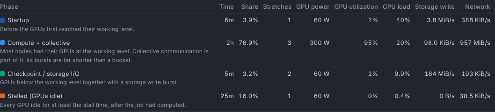

# Job Phases

The **Job phases** section of the [Job Dashboard](./job-dashboard.md) splits a job's run into stretches and says how much time the job spent in each phase: startup, compute, checkpoint, stalled. Time that fits no phase is shown as **Unclassified**, with the reason, and time without GPU telemetry as **No GPU data**. Neither is counted as a phase.

The feature is **off by default**. An administrator turns it on per cluster in the [Job Phase Settings](./configuration.md#job-phase-settings). A cluster that does not turn it on shows no section and sends none of its queries.

The phases are labels for what the telemetry of the job's nodes showed. They are not read from the job: the plugin does not know what the job's code did.

## What the section shows

- **Breakdown bar and legend**: the share of the analysed window per label, for example `3.9% Startup, 76.9% Compute + collective, 3.2% Checkpoint / storage I/O, 16.0% Stalled (GPUs idle)`. The shares are printed with one decimal and add up to 100.0%. Unclassified time and time without GPU data have their own shares.
- **Timeline**: the stretches in time order. Hover a stretch to read its window, length and label. Click it to zoom the metric panels to it (a metric must be pinned, so that a panel exists).
- **Notes**: the analysed window and its resolution, and everything that limits the result for this job: missing signals, nodes without telemetry, a node whose GPUs were idle while the job computed.
- **Phase details and telemetry**: per label the time, the share, the number of stretches and the typical telemetry (medians), so that you can check a label against the numbers.
- **Stretches**: every stretch as a table row, with **Zoom** and, when [Annotation Labeling](./annotation-labeling.md) is enabled, **Label…**.
- **What the phases are based on**: the metrics that were read, how much of the window each covers, and the thresholds of this job.

For a running job, a warning appears when the job is stalled now.

## The labels

| Label | What the telemetry showed |
|-------|---------------------------|
| **Startup** | The time before the GPUs first reached their working level. |
| **Compute + collective** | Most nodes had their GPUs at the working level. Collective communication is part of this phase, because its bursts inside a training step are far shorter than a bucket. |
| **Checkpoint / storage I/O** | GPUs below the working level together with a storage write burst. |
| **Stalled (GPUs idle)** | Every GPU of the job idle for at least the stall time, after the job had computed, unless the CPUs were at least as busy as during compute. The label names what was observed: a hang, and a job that waits (an interactive session, a `sleep` at the end), look the same. |
| **Unclassified** | GPU telemetry exists, but the stretch fits none of the four phases. The section gives the reason (see below). |
| **No GPU data** | No node of the job reported GPU telemetry. |

Reasons for **Unclassified**:

| Reason | Example |
|--------|---------|
| GPUs below the working level without a storage write burst, and not idle on every node for the stall time | An evaluation step, a data wait, a short pause between steps |
| GPUs below the working level; the storage write rate is unknown | The cluster exports no storage write series, so a checkpoint cannot be told |
| Every GPU idle for the stall time, but the CPUs were at least as busy as during compute | CPU-only work, or a hang that spins on the CPUs; the telemetry cannot tell them apart |
| Every reporting GPU idle for the stall time, but not every node reported | One node's exporter was down |
| No majority | Half of the nodes at the working level, half not |
| At most half of the nodes reported GPU telemetry | |
| The GPUs never reached a working level in the window | A job that never used its GPUs. It is not reported as stalled: there is no compute to compare with |
| GPU power is flat and there is no utilization series | Working cannot be told from idle |

## How a label is decided

1. **Buckets.** The run is split into buckets of equal length (see [Resolution](#resolution)). Every signal is reduced to one value per node and bucket by the metrics backend.
2. **GPU state of a node in a bucket.**
   - *Idle*: no utilization sample of any GPU of the node exceeds the idle threshold (5%).
   - *Working*: not idle, and the node's mean GPU power and mean GPU utilization both reach half of the job's **working level**.
   - *Below the working level*: everything else with telemetry.
3. **Working level.** The 90th percentile of the node buckets that are not idle, for power and for utilization separately. It is a property of the job, so a power-capped job, or a job on another GPU model, is measured against its own level. A working level in utilization must be at least twice the idle threshold; a job that stays below it has no working level.
4. **The job in a bucket.** *Compute* needs more than half of the job's nodes working. *Every GPU idle* needs all nodes of the job to report and be idle. Most nodes below the working level is *GPUs low*. Anything else is unclassified (no majority, or too few nodes report).
5. **The label.**
   - Compute buckets are **Compute + collective**.
   - GPUs-low buckets before the first compute bucket are **Startup**.
   - GPUs-low buckets with a storage write burst are **Checkpoint / storage I/O**. A burst is a write rate, added over the job's nodes, of at least 1 MiB/s and at least three times the median write rate of the compute buckets.
   - A run of every-GPU-idle buckets that lasts for the stall time (10 minutes) is **Stalled**, unless the CPUs were at least as busy as in the compute buckets.
   - The rest is **Unclassified**.

| Threshold | Kind | Default | Configurable |
|-----------|------|---------|--------------|
| Idle GPU utilization | Absolute: a percentage means the same on every GPU model | 5% | Yes |
| Working level | Relative to the job: 90th percentile of its active node buckets | - | No |
| A node works at | Relative: half of the working level | 0.5 | No |
| Smallest working level | Absolute: twice the idle threshold | 10% | With the idle threshold |
| Stall time | Absolute | 10 minutes | Yes |
| Write burst | Relative: three times the median of the compute buckets | 3x | No |
| Smallest write burst | Absolute, added over the job's nodes | 1 MiB/s | Yes |
| CPU load that speaks against a stall | Relative: the median of the compute buckets, if that is at least 1% | - | No |

GPU power is used only relative to the job, so its unit and the GPU model do not matter. No threshold is in watts.

**Network** (bytes sent and received) is shown per phase as evidence. It decides no label.

## What it can and cannot see

### Resolution

Telemetry arrives at the scrape interval. A bucket holds at least four scrapes and is at least one minute long:

| Scrape interval | Shortest bucket |
|-----------------|-----------------|
| 15 s | 1 min |
| 30 s | 2 min |
| 60 s | 4 min |

Buckets get longer for long jobs (at most 1,440 buckets) and for jobs with many nodes (at most 24,000 node buckets per query). A 3-day job on 2 nodes at a 60 s scrape interval gets 4-minute buckets; a 1-day job on 256 nodes gets 20-minute buckets. The section states the bucket length of each result.

What follows from this:

- A stretch must fill most of a bucket to change the bucket's label. A stretch much shorter than a bucket is **not visible**; its time is part of the surrounding label.
- A boundary is right to within one bucket.
- A stretch of about half a bucket to one bucket is seen in some cases only, and then reported as one whole bucket.
- From two buckets on, a stretch is seen reliably.
- Bursts of collective communication inside a training step last milliseconds. They are not visible at any bucket length, which is why compute and collective are one phase.
- Evaluation on the GPUs looks like compute. A phase is told by GPU activity, not by what the code does.
- A checkpoint that is written in the background while the GPUs keep working is not a phase of its own: the job computes.
- A job that alternates between GPU work and waiting with a period near the bucket length (seconds to minutes) gets many short unclassified stretches: each bucket holds only a few samples of each GPU.

Measured on generated jobs with a known timeline, sampled like a real exporter, with noise (20 jobs per row; `src/pages/JobDashboard/phases/accuracy.test.ts`):

| Scrape, bucket | Buckets that lie inside one phase, labelled right | Boundary error, mean | Boundary error, largest |
|----------------|---------------------------------------------------|----------------------|-------------------------|
| 15 s, 1 min | 3007 of 3007 | 14 s | 39 s |
| 30 s, 2 min | 3000 of 3000 | 33 s | 76 s |
| 60 s, 4 min | 3000 of 3000 | 61 s | 138 s |

The wrong labels are all in buckets in which two phases meet. Share of the true checkpoint time that is reported, by checkpoint length, in 1-minute buckets: 15 s: 0%; 30 s: 30%; 45 s: 85%; 60 s: 81%; 90 s: 91%; 2 min: 91%; 5 min: 96%.

These numbers come from generated data. Real telemetry has not been measured.

### Checkpoints need a write series

A checkpoint is reported only where the configured storage write metrics show a burst. The default, `node_disk_written_bytes_total`, covers **local disks only**. A checkpoint to a network file system (Lustre, GPFS, NFS) does not show in it: the GPUs dip, and the dip is unclassified. To see such checkpoints, name a client-side write counter of that file system in the settings. Without any write series, no checkpoint is reported and the notes say so.

### Stalls

- **Idle between steps** is not a stall: an idle stretch shorter than the stall time is unclassified.
- **A finished job** is not read past its end, and a running job is read up to one minute plus two scrape intervals before now, so that samples that are not stored yet do not read as missing or idle.
- **Missing data** is never idle. A bucket without GPU telemetry is *No GPU data*, and it ends a run of idle buckets.
- **One stalled node of many**: the job stays in compute while most nodes work. The notes name the node and how long its GPUs were idle.
- **CPU-only work** with idle GPUs and busy CPUs is unclassified, not stalled. A hang that spins on the CPUs looks the same and is unclassified too. The CPU load of the stretch is shown.
- **A GPU that spins at full utilization** without doing work is not idle. It is seen only through power: when the power is under half of the working level, the stretch is unclassified (GPUs low).
- **A long checkpoint to storage without a write series** (longer than the stall time) is reported as stalled.
- **A suspended job** has idle GPUs. The plugin knows only whether the job is suspended now and says so; an earlier suspension reads as a stall.
- **A job that Slurm records as running after it ended** (a runaway job) has idle GPUs and reads as stalled now.
- **A hang that keeps the GPUs busy** looks like compute.
- The stall time is counted over a run in which no reporting GPU was active and more than half of the nodes reported. A bucket is labelled stalled only when every node reported in it.

### Nodes and GPUs

- GPU telemetry is read **per node**. When the job's nodes report more GPUs than the job allocated, the node averages would include other jobs, and the section gives **no result** for the job. Anything that makes a node export more utilization series than Slurm counts GPUs has the same effect: the same exporter stored twice (set the cluster's Metrics Filter to one copy), or one series per GPU partition.
- When fewer GPUs report than the job allocated, the result covers the GPUs that report, and the notes say so. A GPU whose series is missing while the other GPUs of its node report is not noticed.
- CPU load, storage write and network are node-wide. Another job on the same node adds to them.
- A job on nodes with different GPU models has one working level for all nodes. The nodes with the weaker GPUs can read as below the working level.
- The working level is the level the GPUs held or exceeded in a tenth of their active buckets. A job with short bursts at a much higher level than its steady work has that steady work reported as unclassified (GPUs low).

### Edges

Bucket boundaries are multiples of the bucket length, so less than one bucket at each end of the run is outside the buckets. The section states how much. On VictoriaMetrics a rate reaches back one scrape interval before its bucket, so a checkpoint can be reported up to one bucket longer.

## When there is no result

| Message | Queries sent |
|---------|--------------|
| The job has not started, or has no node | 0 |
| The job is too short (fewer than 5 buckets fit into the run) | 0, or 2 when the scrape interval decides it |
| The job has more than 4,800 nodes | 0 |
| The job allocated no GPU and its nodes report no GPU utilization | 1 |
| The job's nodes report more GPUs than the job allocated | 1 |
| The job's nodes report no GPU telemetry in the run | 5 |

A query that fails is reported as an error with **Retry**. It is never read as "no telemetry".

## Cost

Opening a job of a cluster with the feature on sends at most 8 queries to the metrics datasource, one after another, through Grafana's datasource proxy with the viewer's permissions: 2 instant queries (scrape interval, GPUs per node) and 6 range queries (GPU utilization maximum and mean, GPU power, CPU load, storage write, network). Every query aggregates per node in the backend, so a response holds at most 24,000 points, whatever the number of GPUs and the length of the job. The backend still reads the raw samples of the job's window once per query, like one aggregated dashboard panel over the job's time range. Leaving the page stops the queries that were not sent yet.

The result is computed once when the page opens, and again on **Refresh**.

## Labels from stretches

With [Annotation Labeling](./annotation-labeling.md) enabled, each row of **Stretches** has a **Label…** button. It opens the label dialog with the stretch's window, the category `phase-<label>` (for example `phase-checkpoint`) and a note that names the detection. The dialog shows the exact tags. **Nothing is written to Grafana until you click Save label**; Cancel writes nothing. A saved label is an ordinary label of the job: it appears in *Labels for this job*, is drawn on the panels, and can be deleted there.

The plugin never writes annotations for phases on its own, and there is no action that saves several stretches at once.
