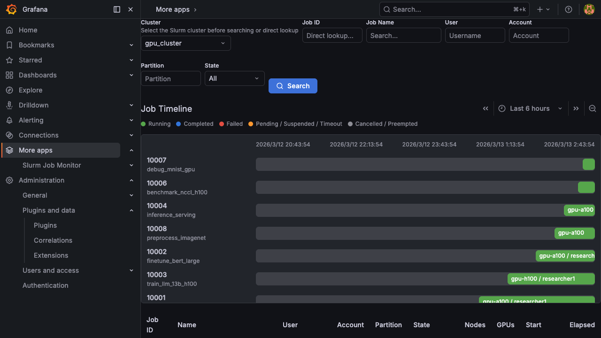

# Job Search

The Job Search page is the main entry point for finding and browsing Slurm jobs. It provides filters, an interactive timeline, and a sortable job table.

## Cluster Selection

Select the target Slurm cluster from the **Cluster** dropdown at the top of the page. If your Grafana instance monitors multiple clusters, each cluster has its own jobs and metrics datasource.

## Filters

Use the filter bar to narrow down jobs:

| Filter | Description |
|--------|-------------|
| **Job ID** | Direct lookup by Slurm job ID. Bypasses other filters and jumps straight to the job dashboard. |
| **Job Name** | Search by job name with autocomplete suggestions |
| **User** | Filter by the submitting user (autocomplete) |
| **Account** | Filter by Slurm account (autocomplete) |
| **Partition** | Filter by Slurm partition (autocomplete) |
| **State** | Filter by job state: All, Running, Completed, Failed, Pending, Cancelled, Timeout |
| **Nodes (min / max)** | Filter by allocated node count. Specify a minimum, maximum, or both to define a range. |
| **Elapsed (min / max)** | Filter by wall-clock runtime. Enter hours and minutes (e.g., `1 h 30 m`). For running jobs the elapsed time is calculated up to now. Pending jobs (not yet started) are automatically excluded. |

Click the **Search** button to apply filters. Filter values are saved to your browser's local storage and restored on your next visit.

## Job Timeline

The timeline visualization shows jobs as horizontal bars on a time axis. Each bar represents a single job, color-coded by state:

- **Green**: Running
- **Blue**: Completed
- **Red**: Failed
- **Orange**: Pending / Suspended / Timeout
- **Gray**: Cancelled / Preempted

The timeline displays job ID, name, partition, user, and node count. Use the time range picker (default: last 6 hours) and the navigation arrows to pan across time.

Click any bar to open the job's dashboard.

## Job Table

Below the timeline, a table lists all matching jobs with the following columns:

| Column | Description |
|--------|-------------|
| Job ID | Slurm job identifier |
| Name | Job name |
| User | Submitting user |
| Account | Slurm account |
| Partition | Slurm partition |
| State | Color-coded state badge |
| Nodes | Number of allocated nodes |
| Node List | Allocated nodes in Slurm notation |
| GPUs | Total GPU count (or `-` if none) |
| Start | Job start timestamp |
| Elapsed | Wall-clock duration |
| Avg CPU% | Mean CPU utilization of the job's nodes over the job's run |
| Avg GPU% | Mean GPU utilization of the job's nodes over the job's run (or `-` if the job has no GPUs) |
| Idle GPU-h | Lower bound of the GPU-hours in which the job's GPUs stayed idle, see [Idle GPU-hours](#idle-gpu-hours) |

Click any row to open the [Job Dashboard](./job-dashboard.md) for that job.

### Idle GPU-hours

The **Idle GPU-h** column helps to find the jobs that waste the most GPU time. Select **Sort by: Idle GPU-hours** above the table to put the jobs with the most idle GPU-hours first. Use the filters (user, partition, time range) to rank the jobs of one user or partition.

The value is computed like **Idle GPU time** in the job's [Efficiency](./job-efficiency.md#idle-gpu-time) scorecard: a GPU is idle in a time bucket when none of its utilization samples exceeds the cluster's idle baseline (default 5%). It is shown as `≥ 4.5` because it is a lower bound of the scorecard's value:

- All jobs of a loaded page share one set of buckets, from the earliest start to the latest end of the page. So the buckets are longer than in the scorecard (at least 60 seconds, at most 6 hours). One active sample marks a whole bucket as active.
- Only the buckets that lie fully inside a job are used. A bucket that crosses the job's start or end also holds samples of the jobs before and after it on the same nodes.
- On nodes that report more GPUs than the job allocated, only GPUs that no job used are counted, and only in buckets in which every GPU of these nodes reports.
- GPU time without telemetry counts as neither idle nor active. The tooltip states how much it is.

The value follows the same rule as the scorecard: [telemetry that cannot be matched to the job](./job-efficiency.md#which-series-belong-to-the-job) gives no number. One check of the scorecard is missing here: the batch counts the GPUs of a node without their IDs, so it cannot see a node that reports only some of its GPUs. For such a job the column can show a number where the scorecard says **Inconclusive**. Hover over a value for the share of the scored GPU-hours. Open the job for the exact numbers and the evidence.

A job without a value shows why, and is never counted as zero:

| Cell | Meaning |
|------|---------|
| `-` | Nothing to score: the job has no GPUs, has not started, ran for less than 5 minutes, was suspended during its run, or is recorded as running long past its time limit |
| `no data` | No GPU telemetry for the job's nodes and time |
| `n/c` | Not computed. The tooltip names the reason: a node of the job reports no GPU, or the nodes report fewer GPUs than the job allocated, so the GPUs that report cannot be matched to the job; the job shares its nodes and in no bucket did every GPU report; a node name of the job contains a character, such as a dot, that the plugin cannot put into a query (such a job is left out of the page's queries, so the other jobs are still scored); the jobs of the page span too many nodes or too much time to score together; no bucket of the page lies fully inside the job; or the query failed. For the last three, narrow the time range of the search or open the job. |
| `...` | Still being scored |

A page can span up to 125 days (500 buckets of 6 hours). With many nodes it spans less: nodes x buckets is at most 24,000.

The sort order covers the jobs that are loaded, as the note next to **Sort by** says. Jobs without a value come last. **Show more** loads the next 100 jobs and scores them too. The timeline keeps the start order.

Cost: each loaded page of up to 100 jobs adds two metrics queries, whatever the number of jobs. They run after the page's CPU and GPU utilization queries, one at a time. Each returns one point per node and bucket, at most 24,000 points, and one evaluation reads the samples of one bucket.

The column, the sort control and the two queries are absent for a cluster that [turned job efficiency off](./job-efficiency.md#turning-it-off).

### Pagination

The table and the timeline load 100 jobs at a time, newest start time first (jobs that started in the same second are ordered by descending job ID). **Show more** loads the next 100.

- **Show more** continues the search that loaded the first page: the same submitted filters and the same absolute time range. A relative range such as `now-24h` is resolved once, when you search; edits in the filter bar take effect only when you click **Search**.
- Each page starts right after the last job already loaded, so jobs that start or leave the time range in the meantime never repeat or skip a row. A job shown once is never shown twice. Jobs that started after the first page appear on the next search.
- With a **Node Names** filter, each page looks at up to 10,000 jobs after the last loaded one, and the total counts the jobs already loaded plus the matches among those 10,000.

## Linked Dashboard Picker

When clicking a job, a picker may appear if external dashboards tagged with `slurm-job-link` exist in your Grafana instance. This lets you choose between:

- **Job view**: The built-in per-job dashboard
- **External dashboards**: Custom Grafana dashboards that accept Slurm job variables

The picker remembers your last selection per cluster.
