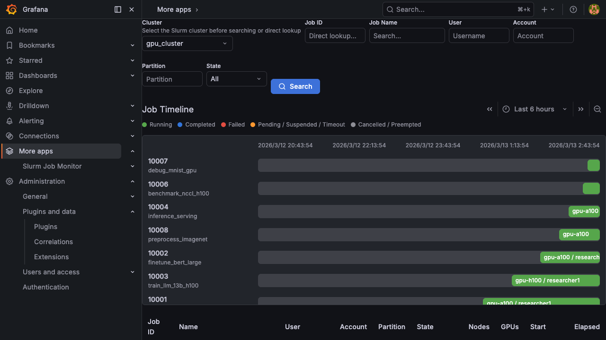

# Job Search

The Job Search page is the main entry point for finding and browsing Slurm jobs. It provides filters, an interactive timeline, and a sortable job table.

## Cluster Selection

Select the target Slurm cluster from the **Cluster** dropdown at the top of the page. If your Grafana instance monitors multiple clusters, each cluster has its own jobs and metrics datasource.

## Filters

Use the filter bar to narrow down jobs:

| Filter | Description |
|--------|-------------|
| **Job ID** | Direct lookup by Slurm job ID. Bypasses other filters and jumps straight to the job dashboard. |
| **Job Name** | Search by job name with autocomplete suggestions |
| **User** | Filter by the submitting user (autocomplete) |
| **Account** | Filter by Slurm account (autocomplete) |
| **Partition** | Filter by Slurm partition (autocomplete) |
| **State** | Filter by job state: All, Running, Completed, Failed, Pending, Cancelled, Timeout |
| **Nodes (min / max)** | Filter by allocated node count. Specify a minimum, maximum, or both to define a range. |
| **Elapsed (min / max)** | Filter by wall-clock runtime. Enter hours and minutes (e.g., `1 h 30 m`). For running jobs the elapsed time is calculated up to now. Pending jobs (not yet started) are automatically excluded. |

Click the **Search** button to apply filters. Filter values are saved to your browser's local storage and restored on your next visit.

## Job Timeline

The timeline visualization shows jobs as horizontal bars on a time axis. Each bar represents a single job, color-coded by state:

- **Green**: Running
- **Blue**: Completed
- **Red**: Failed
- **Orange**: Pending / Suspended / Timeout
- **Gray**: Cancelled / Preempted

The timeline displays job ID, name, partition, user, and node count. Use the time range picker (default: last 6 hours) and the navigation arrows to pan across time.

Click any bar to open the job's dashboard.

## Job Table

Below the timeline, a table lists all matching jobs with the following columns:

| Column | Description |
|--------|-------------|
| Job ID | Slurm job identifier |
| Name | Job name |
| User | Submitting user |
| Account | Slurm account |
| Partition | Slurm partition |
| State | Color-coded state badge |
| Nodes | Number of allocated nodes |
| GPUs | Total GPU count (or `-` if none) |
| Start | Job start timestamp |
| Elapsed | Wall-clock duration |

Click any row to open the [Job Dashboard](./job-dashboard.md) for that job.

### Pagination

The table and the timeline load 100 jobs at a time, newest start time first (jobs that started in the same second are ordered by descending job ID). **Show more** loads the next 100.

- **Show more** continues the search that loaded the first page: the same submitted filters and the same absolute time range. A relative range such as `now-24h` is resolved once, when you search; edits in the filter bar take effect only when you click **Search**.
- Each page starts right after the last job already loaded, so jobs that start or leave the time range in the meantime never repeat or skip a row. A job shown once is never shown twice. Jobs that started after the first page appear on the next search.
- With a **Node Names** filter, each page looks at up to 10,000 jobs after the last loaded one, and the total counts the jobs already loaded plus the matches among those 10,000.

## Linked Dashboard Picker

When clicking a job, a picker may appear if external dashboards tagged with `slurm-job-link` exist in your Grafana instance. This lets you choose between:

- **Job view**: The built-in per-job dashboard
- **External dashboards**: Custom Grafana dashboards that accept Slurm job variables

The picker remembers your last selection per cluster.
